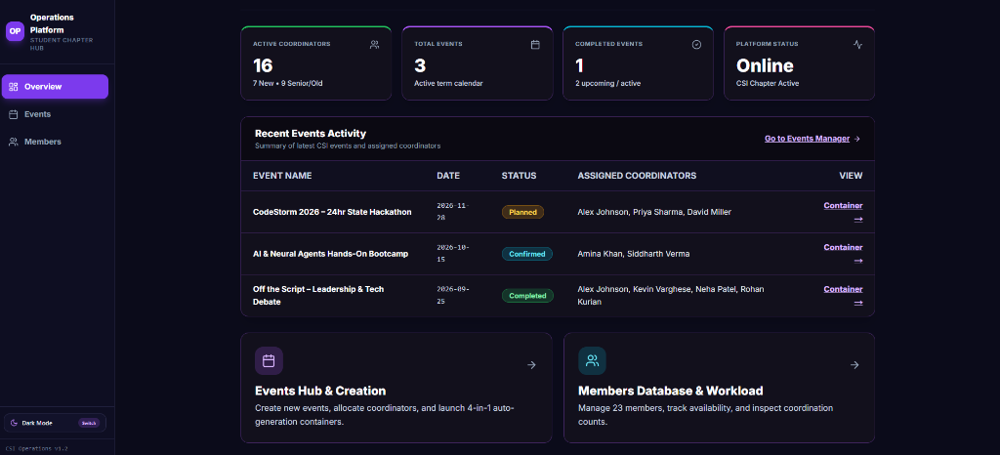
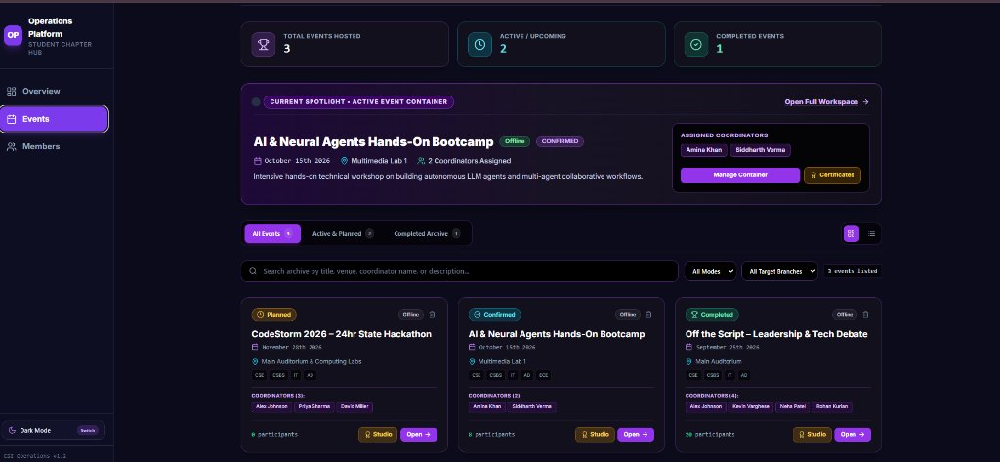
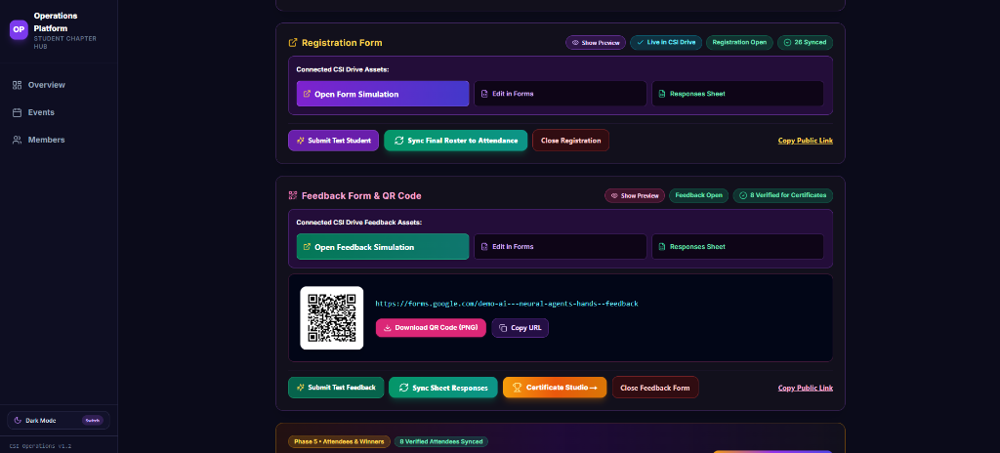

# Operations Platform 🚀

[](https://operationpublics.vercel.app/)
[](https://nextjs.org/)
[](https://www.typescriptlang.org/)
[](https://tailwindcss.com/)
[](LICENSE)

An all-in-one operational orchestration and event automation platform designed for **student technical societies, college clubs, and university chapters**.

> 🌐 **Live Interactive Demo**: You can test the platform live in your browser without cloning or running commands on your laptop 👉 **[operationpublics.vercel.app](https://operationpublics.vercel.app/)**

Instead of juggling separate spreadsheets, disconnected Google Forms, manual Word documents, and Canva templates, this platform streamlines the **entire event lifecycle** into a single dashboard: coordinator workload balancing, institutional permission letters, automated registration forms, attendance rosters, NBA/NAAC outcome feedback, and a visual Certificate Studio with batch ZIP exports.

---

## 🌟 Quick Overview: How the Platform Works

```
┌────────────────────────────────────────────────────────────────────────┐
│                      STUDENT CHAPTER EVENT LIFECYCLE                   │
│                                                                        │
│  1. Event Creation ➔ Workload Allocation ➔ Official Permission Letter  │
│                           │                                            │
│                           ▼                                            │
│  2. Registration Form ➔ Live Attendance Roster ➔ Word/PDF Sheets       │
│                           │                                            │
│                           ▼                                            │
│  3. Feedback Survey (PO10/11) ➔ Merit Winners ➔ Certificate Studio     │
│                           │                                            │
│                           ▼                                            │
│  4. Custom PPTX / Vector Canvas ➔ Batch Dual-Folder ZIP Download       │
└────────────────────────────────────────────────────────────────────────┘
```

1. **Create Events & Balance Workload**: Select event mode (Online/Offline), date, venue, and target departments. The allocation algorithm highlights senior mentors vs. junior coordinators to keep workloads balanced.
2. **Generate Official Approvals**: Instantly exports formal **Principal Permission Letters** and **Campus Intranet (RSMS) Notices** in editable Word (`.docx`) and vector PDF formats.
3. **Registration & Attendance**: Generate registration forms with a single click. Track check-ins live on event day and export formatted **Attendance Sign-in Sheets** with official emblems and faculty sign-off blocks.
4. **Outcome-Based Feedback**: Collect feedback mapped directly to NBA/NAAC criteria (**PO10 - Communication** & **PO11 - Project Management**). Attendees verify their certificate name spelling upon submission.
5. **Certificate Studio**: Upload your club's PowerPoint (`.pptx`) or image template, drag and position text fields visually on screen with live preview, and download organized ZIP archives with 1st/2nd/3rd place and participant certificates.

---

## 📸 Interface & Workflow Previews

### 1. Operations KPI Dashboard
Real-time chapter overview tracking active coordinators, senior vs. junior distribution, and recent event activities.


### 2. Events Hub & Active Management Archive
Spotlight containers with live statuses, assigned coordinator tags, and one-click access to approvals and workspaces.


### 3. Event Workspace & Interactive Form Simulator
Self-contained registration and feedback simulators with live attendance sync, QR codes, and Certificate Studio integration.


---

## 🚀 Quick Start: Try the App

### Option A: Test the Live Interactive Demo (Instant in Browser)
No installation or cloning required! Navigate directly to:
👉 **[https://operationpublics.vercel.app](https://operationpublics.vercel.app/)**  
*(Test coordinator balancing, interactive registration/feedback forms, and the Certificate Studio directly on desktop or mobile).*

---

### Option B: Run Locally (Sandbox Mode)

The repository runs out-of-the-box in **100% Client-Side Sandbox Mode**:
* **No Database or API Keys Needed**: Everything runs locally inside your browser via `localStorage`.
* **Zero External Calls**: Google Drive operations and forms are simulated safely in-app.
* **Pre-Loaded Sample Data**: Comes with 3 ready-to-test containers:
  * 📋 **Planned**: *CodeStorm 2026* (test coordinator assignment & letter generation).
  * 🟢 **Ongoing**: *AI & Neural Agents Bootcamp* (with 25 sample registered attendees for attendance rosters).
  * 🏆 **Completed**: *Off the Script* (with 20 feedback responses, merit winners, and certificate generator).
* **1-Click Reset**: Click the **"🔄 Reset Demo Data"** banner button anytime to restore fresh sample data.

### Running the App:
```bash
# 1. Clone the repository
git clone https://github.com/Aronjohn20/Operation_Public.git
cd Operation_Public

# 2. Install dependencies
npm install

# 3. Start the development server
npm run dev
```
Open **[http://localhost:3000](http://localhost:3000)** in your browser.

---

## 🎨 Customizing the Platform for Your Club

This project is built to be easily adapted to any college club or student organization.

### 1. Customizing Club Structure & Members
* **Member Roster & Roles**: Edit [`src/lib/data.ts`](src/lib/data.ts) to define your club's executive domains (Technical, Operations, Creative, Marketing) and member tiers (`old_coordinator` for seniors, `new_coordinator` for juniors).
* **Departments & Branches**: Change the target academic branches (e.g., `CSE`, `ECE`, `IT`, `ME`, `AIDS`) in [`src/lib/types.ts`](src/lib/types.ts) and [`src/lib/formScriptGenerator.ts`](src/lib/formScriptGenerator.ts).
* **Club Logos & Branding**: Replace sample emblems in `public/logos/` with your own chapter's high-resolution emblems, or edit [`src/lib/logosBase64.ts`](src/lib/logosBase64.ts).

### 2. Customizing Certificates (PowerPoint Engine & Future Scope)

Certificates can be fully personalized to match your club's design aesthetic. The certificate system lives in two core files:
* **UI & Studio Controls**: [`src/app/events/[id]/certificates/page.tsx`](src/app/events/[id]/certificates/page.tsx) — Handles template uploads, winner selections (1st, 2nd, 3rd place), live canvas previews, and folder download triggers.
* **Batch Export Engine**: [`src/lib/certificateExport.ts`](src/lib/certificateExport.ts) — Parses PowerPoint XML, replaces dynamic placeholders (`<<name>>`, `<<position>>`), and packages dual-folder ZIP archives via JSZip.

#### How It Works:
* **Native PowerPoint (`.pptx`) Generation**: Upload your organization's custom `.pptx` template. The platform dynamically swaps attendee names and merit rankings while preserving 100% of your PowerPoint fonts, vector shapes, gradients, and logos.
* **Automatic Merit Ordinals**: Renders true superscript ordinals ($1^{st}$, $2^{nd}$, $3^{rd}$) for winners and formats participant names automatically.
* **Organized Dual-Folder ZIPs**: Generates separate archives for `Winners_Appreciation_Certificates/` and `Participation_Certificates/`.

> [!TIP]
> **🚀 Future Scope — Direct Cloud PDF Conversion**:  
> Currently, the platform exports high-fidelity `.pptx` presentations so chapter leads have fully editable master slides. A planned future enhancement is an automated serverless conversion pipeline (via headless LibreOffice / Chromium) to seamlessly compile `.pptx` templates into distribution-ready vector `.pdf` files directly within the web app.

---

## ☁️ Google Workspace Automation (Optional Setup)

> [!IMPORTANT]
> **Why "Edit in Forms" is simulated in Sandbox / Demo Mode**:  
> In the demo/sandbox mode, registration and feedback forms run completely inside your browser via local simulation. Because a real form has not been provisioned inside your Google Drive yet, external Google actions like **"Edit in Forms"** or direct Drive links cannot be edited online. To create and manage real, live Google Forms and linked Sheets inside your chapter's Google Drive, deploy the Google Apps Script provided in the [`scripts/`](scripts/) folder as explained below.

In addition to the in-app interactive simulation, this project includes production-ready **Google Apps Script** automation scripts in the [`scripts/`](scripts/) folder.

### What the Scripts Do:
* **[`scripts/google_apps_script_registration.js`](scripts/google_apps_script_registration.js)**: A standalone script that uses Google's `FormApp` and `SpreadsheetApp` APIs to build a registration form with your event's exact department options and connect it to a Google Sheet in seconds.
* **[`scripts/csi_master_webhook.js`](scripts/csi_master_webhook.js)**: A unified master webhook hub that handles both Registration and Feedback surveys, syncs responses back to your web app, and manages form status.

### How to Hook Up Live Google Drive Automation:
1. Open [script.google.com](https://script.google.com) in your club's Google account and create a new project.
2. Copy and paste the code from [`scripts/csi_master_webhook.js`](scripts/csi_master_webhook.js) into the editor.
3. Click **Deploy > New deployment > Web app**:
   * **Execute as**: *Me*
   * **Who has access**: *Anyone*
4. Copy the generated Web App URL and add it to your `.env.local`:
   ```env
   NEXT_PUBLIC_CSI_GOOGLE_WEBHOOK_URL=https://script.google.com/macros/s/YOUR_DEPLOYMENT_ID/exec
   NEXT_PUBLIC_CSI_FEEDBACK_WEBHOOK_URL=https://script.google.com/macros/s/YOUR_FEEDBACK_WEBHOOK_ID/exec
   ```
*(Note: The codebase contains zero hardcoded API keys or webhook URLs. Live automation runs strictly through your own environment variables).*

---

## 🗄️ Database Setup (Optional Supabase Backend)

If you wish to sync data to a real cloud PostgreSQL database instead of purely using `localStorage`:
1. Create a free project at [supabase.com](https://supabase.com).
2. Run the SQL migration scripts in order from the [`supabase/`](supabase/) directory:
   * `01_schema.sql` (Tables for events, members, coordinator assignments)
   * `02_seed_members.sql` (Sample roster)
   * `03_seed_events.sql` (Sample event containers)
   * `04_rls_policies.sql` & `05_triggers.sql`
3. In [`src/lib/supabaseClient.ts`](src/lib/supabaseClient.ts), enable the client with your credentials from `.env.local`.

---

## 📂 Project Structure

```
├── docs/screenshots/       # High-resolution interface previews for README
├── public/                 # Static assets, logos, and sample certificate templates
│   └── logos/              # Sample institute and chapter emblems
├── scripts/                # Reusable Google Apps Script automation templates
│   ├── csi_master_webhook.js                 # Dual-pipeline master webhook hub
│   └── google_apps_script_registration.js    # Standalone form & sheet generator
├── src/
│   ├── app/                # Next.js 14 App Router
│   │   ├── api/google-form/route.ts          # Simulated sandbox API dispatcher
│   │   ├── events/                           # Event Management Hub & Archive
│   │   │   └── [id]/                         # Event Container (Forms, Attendance, Letters)
│   │   │       └── certificates/page.tsx     # Certificate Studio & Winner Assignment
│   │   ├── members/page.tsx                  # Member Directory & Workload Table
│   │   ├── layout.tsx                        # Root layout with DemoBanner & theme tokens
│   │   └── page.tsx                          # KPI Operations Dashboard
│   ├── components/         # Modular UI Components
│   │   ├── CreateEventModal.tsx              # Multi-step event creation wizard
│   │   ├── DemoBanner.tsx                    # Sandbox mode indicator & Reset button
│   │   ├── Navbar.tsx                        # Navigation sidebar with dark/light theme
│   │   └── SimulatedFormModal.tsx            # In-app Google Form simulator
│   └── lib/                # Core Business Logic & Document Engines
│       ├── certificateExport.ts              # jsPDF vector engine & JSZip batch packager
│       ├── data.ts                           # Default sample members & event containers
│       ├── documentExport.ts                 # Word (.docx) & PDF Attendance / Letter generator
│       ├── eventsStorage.ts                  # LocalStorage state engine & Supabase sync
│       ├── feedbackFormGenerator.ts          # PO10/PO11 Outcome survey script builder
│       └── formScriptGenerator.ts            # Dynamic Apps Script code generators
├── supabase/               # PostgreSQL schema & migration scripts
├── .env.example            # Environment variables template
├── LICENSE                 # MIT License file
├── package.json            # Project dependencies & scripts
└── tailwind.config.ts      # Custom theme color tokens
```

---

## 🛡️ License

This project is licensed under the [MIT License](LICENSE) — you are free to fork, customize, and deploy it for your own student chapter, university club, or technical organization!
